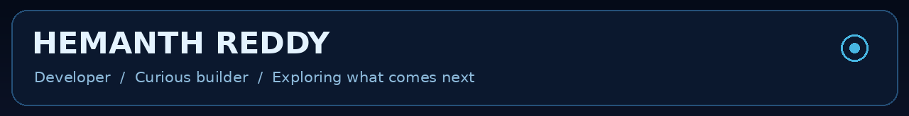
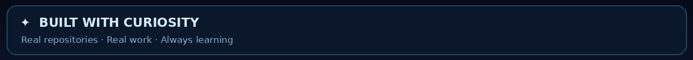
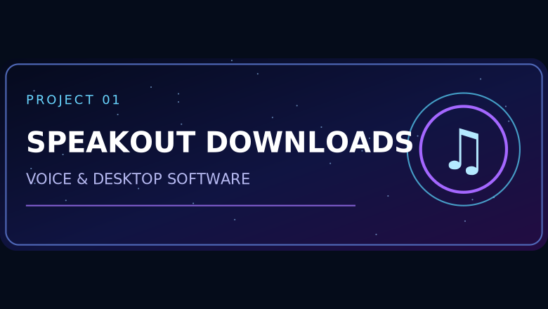
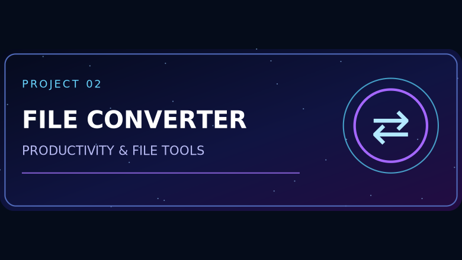
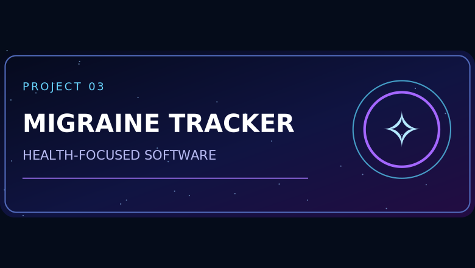

 

**[OVERVIEW](https://github.com/hemanth-reddy18)** · **[REPOSITORIES](https://github.com/hemanth-reddy18?tab=repositories)** · **[CONTRIBUTIONS](https://github.com/hemanth-reddy18?tab=overview)**

### ✦ About me

Hi, I'm Hemanth. I enjoy exploring technology, experimenting with ideas, and learning by building. Some ideas become projects, and others help me learn something useful. I'm always looking for ways to make things better.

| | |
|:--|:--|
|  |  |
| **[🎙 Speakout Downloads](https://github.com/hemanth-reddy18/speakout-downloads)** — Public downloads for Speakout. | **[📁 File Converter](https://github.com/hemanth-reddy18/file-converter)** — A file conversion project. |
|  | **✧ Still exploring** — Building and learning one project at a time. |

### ✦ GitHub activity

[View my real contribution activity](https://github.com/hemanth-reddy18?tab=overview)

---

*Stay curious · Keep building*

